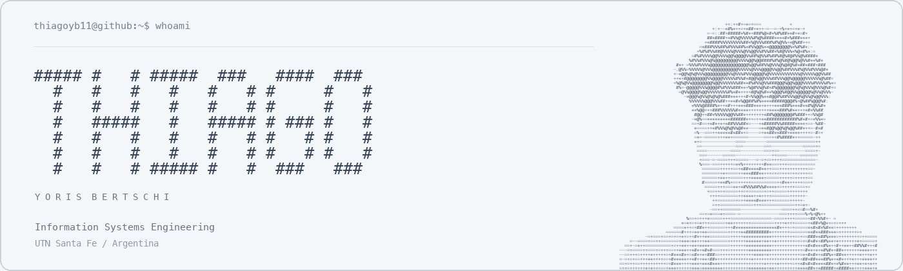

<picture>
  <source media="(prefers-reduced-motion: reduce)" srcset="./assets/header-ascii-light.png">
  
</picture>

## About me

I'm an Information Systems Engineering student at Universidad Tecnológica
Nacional, Facultad Regional Santa Fe, Argentina.

I enjoy building applications, solving algorithmic problems, and learning through
hands-on projects. My interests include web development, developer tools, and
making technical concepts easier to understand through visualization.

## Technologies

| Area | Technologies |
| :--- | :--- |
| Languages | &nbsp;Python, &nbsp;TypeScript, &nbsp;C++, &nbsp;Java |
| Frontend | &nbsp;React, &nbsp;Tailwind CSS |
| Backend | &nbsp;Spring Boot, JPA, &nbsp;Rust, Axum |
| Databases | &nbsp;PostgreSQL, &nbsp;MySQL |
| Scientific computing | &nbsp;NumPy, &nbsp;Pandas, &nbsp;Matplotlib, &nbsp;ScikitLearn |

## Background

- **Competitive programming:** Torneo Argentino de Programación (2025, 2026)
  and Tecnomate UTN FRSF (2025).
- **Languages:** Spanish, English.

---

[Email](mailto:thiagoyorisbertschi@gmail.com) · [GitHub](https://github.com/thiagoyb11)

---

<h2 align="center">“And God said, Let there be light: and there was light.”</h2>

<em>-God, first prompt engineer</em>

